# contrib-aquarium

<p align="center">
  
</p>

<p align="center">
  <a href="https://github.com/webywz/contrib-aquarium/actions/workflows/ci.yml"></a>
  <a href="LICENSE"></a>
  <a href="https://www.npmjs.com/package/contrib-aquarium"></a>
  <a href="https://www.npmjs.com/package/contrib-aquarium"></a>
</p>

<p align="center">
  <strong>A living SVG aquarium driven by a GitHub contribution graph.</strong><br/>
  Drop one image into a profile README. Activity becomes fish, kelp, bubbles, and water.
</p>

<p align="center">
  <strong>由 GitHub 贡献日历驱动的活体 SVG 鱼缸。</strong><br/>
  把一张图放进 README，提交就变成鱼、海藻、气泡和水纹。
</p>

Self-contained SVG (CSS + SMIL) — no JavaScript in the embed, so GitHub can host it as a normal image. Dark water, brass rim; readable on light and dark themes.

自包含 SVG（CSS + SMIL），嵌入不需要 JS，可当普通图片用。暗水色 + 铜框，浅色 / 深色主题都站得住。

`npx contrib-aquarium` · package `contrib-aquarium` · v0.1.8 · Node.js 18.18+

---

## Features · 特性

| | EN | 中文 |
| --- | --- | --- |
| Mapping | Year total → fish count; streaks → kelp; last 14 days → bubbles | 全年总数 → 鱼数；连续打卡 → 海藻；近两周 → 气泡 |
| Sources | GraphQL calendar, public events, or deterministic mock | GraphQL 日历 / 公开 Events / 确定性 mock |
| Themes | `deep` · `reef` · `midnight` (palette only) | 三种配色，布局与映射不变 |
| Embed | Commit SVG, or refresh daily via composite Action | 提交 SVG，或用 Action 每日重画 |
| API | CLI + TypeScript library | CLI + 库 |

---

## Install · 安装

```bash
npx contrib-aquarium generate --user YOUR_LOGIN --out aquarium.svg

# or globally
npm i -g contrib-aquarium
contrib-aquarium generate --user YOUR_LOGIN --out aquarium.svg
```

Token optional. Without one, public events or a username-hash mock still render — demos never go blank.

没有 token 也能跑：公开 Events 或按用户名哈希的演示日历会顶上，预览不会空。

From source:

```bash
git clone https://github.com/webywz/contrib-aquarium.git
cd contrib-aquarium
npm install
npm run generate -- --user YOUR_LOGIN --out aquarium.svg
```

---

## Quick start · 快速开始

```bash
# real calendar (needs token)
export GITHUB_TOKEN=ghp_...
npx contrib-aquarium generate --user webywz --out aquarium.svg

# recent public events only
npx contrib-aquarium generate --user webywz --source events --out aquarium.svg

# offline demo (byte-stable for a given UTC day)
npx contrib-aquarium generate --user webywz --source mock --out aquarium.svg

# theme
npx contrib-aquarium generate --user webywz --theme reef --out aquarium.svg

# list available themes
npx contrib-aquarium --list-themes
npx contrib-aquarium --list-themes --json
```

In a README:

```markdown
<p align="center">
  
</p>
```

Or a raw URL from another repo:

```markdown

```

---

## Data sources · 数据来源

`--source auto` (default) tries in order:

| Priority | Source | Token | Result |
| --- | --- | --- | --- |
| 1 | GraphQL `contributionsCollection` | yes (`--token`, `GITHUB_TOKEN`, or `GH_TOKEN`) | Full last-year calendar |
| 2 | Public events `GET /users/{login}/events/public` | no | Recent activity (~90 days retained) |
| 3 | Mock from username hash | no | Stable fake year for CI / demos / offline |

Pin a path with `--source graphql|events|mock`.

`--source auto` 按上表回退。GraphQL 要 token，拿完整贡献日历；公开 Events 不要 token，只有最近活动；mock 用用户名哈希生成确定假日历，保证离线 / CI / 演示出图。

Fine-grained or classic PAT that can read public user data is enough. In Actions, `secrets.GITHUB_TOKEN` covers public calendars.

---

## How activity becomes an aquarium · 贡献如何变成鱼缸

| Signal | Becomes · 变成 |
| --- | --- |
| Yearly contribution total | School size 3–18 fish · 鱼数量 `round(3 + sqrt(total) × 0.48)` |
| Busiest weeks | Larger koi / centerpiece angelfish · 更大锦鲤 / 主鱼 |
| Current streak | Kelp height and count · 海藻高度与簇数 |
| Last 14 days | Bubble density · 气泡密度 |
| Each week's total | Pebble / reef bed · 沙地礁石起伏 |
| Activity density | Water and plant motion · 水纹与海藻摆动 |

Empty years still get a few wanderers. Same username + calendar snapshot → same tank.

空年份仍有几条游鱼。同一用户名 + 同一日历快照，画出同一座缸。

---

## Themes · 主题

`--theme` changes palette only — layout and activity mapping stay the same.

| Name | Feel · 观感 |
| --- | --- |
| `deep` (default) | Classic dark teal · 默认深青 |
| `reef` | Warmer tropical water · 暖色珊瑚 |
| `midnight` | Violet night, neon accents · 午夜紫 |
| `lagoon` | Fresh green aquatic · 清新绿调 |
| `ember` | Warm amber glow · 琥珀暖光 |
| `fog` | Cool misty gray · 冷雾灰调 |

```bash
npx contrib-aquarium generate --user YOUR_LOGIN --theme midnight --out aquarium.svg
npx contrib-aquarium generate --user YOUR_LOGIN --theme ember --out aquarium.svg
```

---

## Embed size · 嵌入尺寸

`--width` sets the SVG **display** width for README embeds. The internal `viewBox` stays `0 0 860 300`, so fish and layout scale proportionally — never squash.

`--width` 只改 SVG 的展示宽；内部 `viewBox` 仍是 `0 0 860 300`，鱼和构图等比缩放，不会挤扁。

| Flag | Default | |
| --- | --- | --- |
| `--width` | `860` | Display width in px · 展示宽度 |
| `--height` | proportional · 等比 | Display height; omit to keep aspect · 省略则保持比例 |

```bash
# Narrower card for a profile README · 主页 README 窄卡
npx contrib-aquarium generate --user YOUR_LOGIN --width 640 --out aquarium.svg

# Then embed without an extra HTML width attribute · 嵌入时不必再写 HTML width
# 
```

---

## Static mode · 静态模式

`--static` (or `--no-animate`) strips all CSS animations and SMIL `<animate>` tags, so fish and plants rest in place. Useful for printing, email newsletters, or embedding where animations aren't wanted.

`--static`（或 `--no-animate`）移除所有 CSS 动画和 SMIL `<animate>` 标签，让鱼和海藻静止。适合打印、邮件简报，或不需要动画的嵌入场景。

```bash
# Static aquarium for print or email · 静态鱼缸，用于打印或邮件
npx contrib-aquarium generate --user YOUR_LOGIN --static --out aquarium-static.svg

# Works with all themes and sizes · 适用于所有主题和尺寸
npx contrib-aquarium generate --user YOUR_LOGIN --theme ember --static --width 640 --out static-ember.svg
```

Default behavior (without `--static`) includes full animations. The `prefers-reduced-motion` media query already pauses motion for users who request it, but `--static` removes animations entirely from the file.

默认行为（不加 `--static`）包含完整动画。`prefers-reduced-motion` 媒体查询已为需要的用户暂停动效，而 `--static` 则从文件中完全移除动画。

---

## JSON output · JSON 输出

`--json` prints a machine-readable contribution summary to stdout instead of generating SVG. Useful for badge/CI pipelines that need stats without rendering.

`--json` 将机器可读的贡献摘要打印到标准输出，而不生成 SVG。适用于需要统计数据而无需渲染的徽章 / CI 管道。

```bash
# Get JSON summary · 获取 JSON 摘要
npx contrib-aquarium generate --user webywz --json

# Output includes · 输出包含:
# - login, name, totalContributions, source, range
# - streak (current consecutive days), activeDays (days with >0 contributions)
# - recent14 (last 14 days total), fishCount, plantCount, bubbleCount
```

Example output · 输出示例:

```json
{
  "login": "webywz",
  "name": null,
  "totalContributions": 1234,
  "source": "graphql",
  "range": { "from": "2025-10-31", "to": "2026-10-30" },
  "streak": 42,
  "activeDays": 256,
  "recent14": 89,
  "fishCount": 12,
  "plantCount": 11,
  "bubbleCount": 15
}
```

When `--json` is set, `--out` is ignored (nothing is written to disk). `--theme`, `--width`, `--height`, and `--static` have no effect in JSON mode.

设置 `--json` 时，`--out` 被忽略（不写入磁盘）。`--theme`、`--width`、`--height` 和 `--static` 在 JSON 模式下无效。

---

## Interface language · 界面语言

`--locale` controls the language for help text and terminal messages. Defaults to `en`.

`--locale` 控制帮助文本和终端消息的语言，默认 `en`。

```bash
# English interface (default)
npx contrib-aquarium --help

# Chinese interface
npx contrib-aquarium --help --locale zh

# Chinese error messages
npx contrib-aquarium generate --locale zh
# 缺少 --user <login>
```

**JSON keys and values stay English** regardless of `--locale` (machine contract).

**JSON 键和值保持英文**，不受 `--locale` 影响（机器契约）。

---

## Embed daily · 每日嵌入

Copy [`examples/github-action.yml`](examples/github-action.yml) into your **profile** repo (`USER/USER`) as `.github/workflows/aquarium.yml`. It runs on a daily cron + `workflow_dispatch`, uses this repo as a composite action, and commits `aquarium.svg` when the tank changed.

```yaml
# Pin a release tag — avoid @main.
- uses: webywz/contrib-aquarium@v0.1.5
  with:
    user: ${{ github.repository_owner }}
    out: aquarium.svg
    # theme: reef
    # width: 640
    # static: false
```

This project's demo refreshes the same way: [`.github/workflows/daily-aquarium.yml`](.github/workflows/daily-aquarium.yml) updates [`docs/aquarium.svg`](docs/aquarium.svg) for `webywz`.

把示例 workflow 拷到个人主页仓库即可每天重画。GitHub Camo may cache the README thumbnail briefly after a push; the file in the repo is current.

GitHub 的 Camo 代理可能短暂缓存缩略图；仓库里的文件是新的。

---

## CLI

```
contrib-aquarium generate --user <login> [--out aquarium.svg]
                          [--source auto|graphql|events|mock]
                          [--theme deep|reef|midnight|lagoon|ember|fog]
                          [--width <px>] [--height <px>]
                          [--static | --no-animate]
                          [--json]
                          [--token <gh_token>]
                          [--locale <en|zh>]
                          [--quiet]

contrib-aquarium --list-themes [--json] [--locale <en|zh>]
```

| Flag | Default | |
| --- | --- | --- |
| `--user` | required | GitHub login |
| `--out` | `aquarium.svg` | Output path (dirs created) |
| `--source` | `auto` | See data sources |
| `--theme` | `deep` | `deep` · `reef` · `midnight` · `lagoon` · `ember` · `fog` |
| `--width` | `860` | Display width (viewBox fixed) · 展示宽 |
| `--height` | proportional · 等比 | Display height · 展示高 |
| `--static` | off | Strip animations; fish rest · 移除动画 |
| `--no-animate` | off | Same as `--static` · 等同 `--static` |
| `--json` | off | Print JSON summary to stdout · 打印 JSON 摘要到标准输出 |
| `--token` | `$GITHUB_TOKEN` / `$GH_TOKEN` | GraphQL auth |
| `--locale` | `en` | Interface language: `en` or `zh` · 界面语言 |
| `--quiet` | off | Suppress success summary · 关闭成功摘要 |
| `--list-themes` | off | Print available themes (one per line; with `--json`: JSON array) · 打印可用主题 |

```bash
npm run generate -- --user webywz --out docs/aquarium.svg
npm test
npm run build
npm run lint
```

---

## Library · 库

```ts
import { generateAquarium, renderAquarium, mockActivity } from "contrib-aquarium";

const { svg, activity } = await generateAquarium({
  user: "webywz",
  source: "auto",
  theme: "reef",
});

const svgFromMock = renderAquarium(mockActivity("webywz", new Date("2026-10-29")));

// Narrower embed · 窄嵌入（viewBox 仍 860×300）
const narrow = renderAquarium(mockActivity("webywz"), "deep", { width: 640 });
```

Also exported: `loadActivity`, `fetchGraphqlActivity`, `fetchEventsActivity`, `getTheme`, `parseTheme`, `THEME_NAMES`, `resolveSvgDisplaySize`, and size helpers. Types ship with the package.

另导出活动加载、主题解析、`resolveSvgDisplaySize` 与尺寸常量；TypeScript 类型随包发布。

---

## Links · 链接

- npm: [contrib-aquarium](https://www.npmjs.com/package/contrib-aquarium)
- Live on profile: [webywz/webywz](https://github.com/webywz/webywz)
- License: [MIT](LICENSE)
